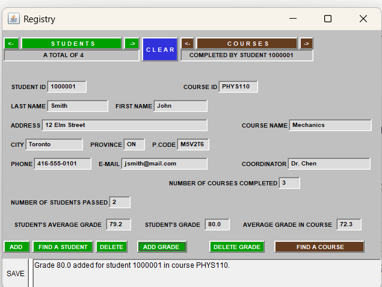

# Registry
A small student registry written in Java AWT. It keeps students, courses and the grades students have earned in courses, and lets you browse, search, add and delete them. Data is loaded from plain text files and can be saved back to them.

It started as an applet (`Registry3`) from a university course project. It still runs as an applet, but the recommended way to run it is through `RegistryApp`, which puts the same screen in a normal window and adds a **SAVE** button.

## Files

| File | Purpose |
|---|---|
| `Registry3.java` | The screen and all button logic (extends `Applet`). |
| `RegistryApp.java` | Launcher: runs `Registry3` in a normal window, adds SAVE and an unsaved-changes prompt. |
| `Student.java`, `Course.java`, `Mark.java` | The three record types. A mark is one student's score in one course. |
| `StudList.java`, `CourList.java`, `MarkList.java` | Lists of those records, indexed by ID for fast lookups. |
| `students.txt`, `courses.txt`, `marks.txt` | The data. |
| `Registry3.html` | Example page for running as an applet (old browsers / Applet Viewer only). |
| `benchmark/` | Optional timing and correctness programs (see below). |

## Data files

One record per line, comma-separated. Blank lines and lines starting with `#` are ignored.

```
students.txt   studentID,last,first,address,city,province,postalCode,phone,email
courses.txt    courseID,name,coordinator
marks.txt      studentID,courseID,score
```

Example:

```
# students.txt
1000001,Smith,John,12 Elm Street,Toronto,ON,M5V2T6,416-555-0101,jsmith@mail.com

# courses.txt
MATH201,Linear Algebra,Dr. Baker

# marks.txt
1000001,MATH201,72
```

Rules to keep in mind:

- Fields cannot contain commas (the comma is the separator).
- Student IDs are seven digits. Course IDs are free text and case-sensitive (`CS101` is not `cs101`).
- Scores are numbers from 0 to 100, and a student has at most one score per course.
- A malformed line is skipped and reported in the console.

## Running it

### In Eclipse (recommended)

1. Put all the `.java` files and the three `.txt` files in your project's `src` folder, then refresh (F5).
2. Right-click `RegistryApp.java` and choose **Run As → Java Application**.

The launcher looks for `students.txt` in `src`, then the project folder, then `bin`. To use another folder, set it under **Run → Run Configurations → Arguments → Program arguments**.

To run it as an applet instead, right-click `Registry3.java` and choose **Run As → Java Applet**. This works, but applets cannot save.

### From the command line

```
javac Registry3.java RegistryApp.java
java RegistryApp path\to\data\folder
```

On Windows `cmd`, `javac *.java` does not work; name the files instead. `javac` finds the other classes by itself.

### Requirements

Developed on Java 8. The applet classes (`java.applet`) are deprecated in recent JDKs, so use an older JDK if a newer one reports that they are missing.

## Using it

The screen has two sides: students on the left, courses on the right.

| Button | What it does |
|---|---|
| **STUDENTS** | Show the first student, with the courses they have completed and their grades. |
| **COURSES** | Show the first course, with the students who have completed it. |
| **`<-` `->`** (beside each heading) | Previous / next student or course. |
| **FIND A STUDENT / FIND A COURSE** | Type an ID, press again to jump to it. |
| **ADD / DELETE** | Add a new student, or delete the one on screen (student mode only). |
| **ADD GRADE / DELETE GRADE** | Give the student or course on screen a grade, or delete the grade on screen. |
| **CLEAR** | Clear the screen and cancel anything pending. |
| **SAVE** | (`RegistryApp` only) Write changes back to the text files. |

Entry and delete buttons work in two presses: the first opens the entry or asks for confirmation (the button turns red), the second commits. While something is pending, other buttons are blocked; press **CLEAR** to cancel. Problems are explained in the status line at the bottom.

### Example: adding a grade

1. Click **STUDENTS** to show student 1000001, John Smith.
2. Click **ADD GRADE**. Type `PHYS110` in COURSE ID and `80` in STUDENT'S GRADE.
3. Click **ADD GRADE** again. The screen jumps to PHYS110 and the student's average updates.

Deleting a student also deletes all of that student's grades. Courses cannot be added or deleted from the screen; edit `courses.txt` for that.

## Saving

Changes exist only in memory until you press **SAVE** (or choose Save when closing the window).

- Only the files that changed are rewritten: `students.txt` and/or `marks.txt`. `courses.txt` is never modified.
- Before overwriting, the previous version is copied to `students.txt.bak` / `marks.txt.bak`. Each save replaces the previous `.bak`.
- Saving writes a temporary file first, so a failed save cannot leave a half-written file.
- A saved file starts with a `# ...` header line describing the columns (any comment lines you had are replaced; your `.bak` keeps them). Scores are written as decimals, e.g. `91.0`.

## Performance

Lists keep ID indexes (hash maps), so lookups do not scan the whole data set. In the included benchmark, clicking a course with 100,000 students and 500,000 marks went from about 3.4 seconds (linear scans) to about 1 ms. At normal class sizes everything is effectively instant.

To reproduce the numbers, compile `benchmark/Bench.java` together with the project and run it with a larger heap:

```
java -Xmx1g Bench
```

`Check.java` prints a checksum over every list operation (it should be identical for the old and indexed list classes), and `Build.java` times the one-time index build. `benchmark/old_lists/` holds the original non-indexed list classes for comparison; do not copy them into the project folder.

## Changes from the original code

- Added `MarkList`, which the original referenced but did not include.
- Data now loads from the text files; the original `<param>` tags in the HTML are still used as a fallback.
- Lists use ID indexes instead of linear scans.
- Implemented ADD, DELETE, ADD GRADE and DELETE GRADE (they were empty stubs).
- Buttons are identified by which button was pressed, not by searching its label text (which would have sent ADD GRADE to the delete-grade handler).
- A mark that refers to a student or course that does not exist is skipped instead of causing a crash.
- Added `RegistryApp` with SAVE support.
